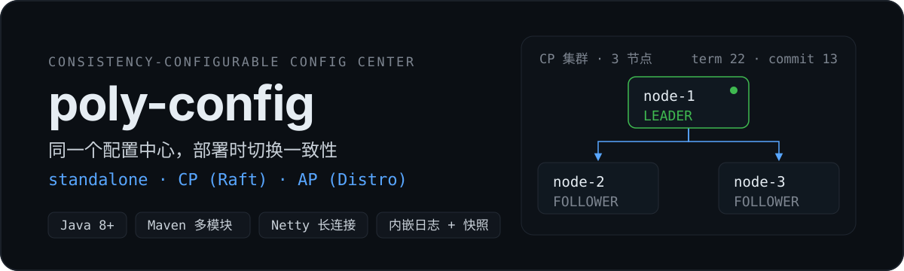
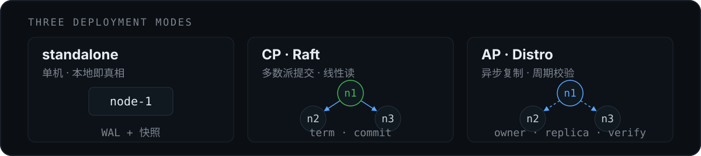

# poly-config

<p align="center">
  
</p>

一个用同一套代码实现 **三种一致性模式** 的配置中心：`standalone` 单机、`CP`（手写 Raft）、`AP`（Distro 式）。数据模型、HTTP API、Java SDK 与 Web 控制台完全一致，差异收敛在服务端协议层——**部署时切换，而不是换一个产品**。

项目重点不在配置 CRUD，而在分布式场景下的工程实现：日志与快照存储、Raft 选举与复制、Distro 反熵收敛、服务端推送，以及这些机制在真实故障下的行为。

[三种模式](#三种部署模式) · [快速开始](#快速开始) · [Java SDK](#java-sdk) · [HTTP API](#http-api) · [设计文档](#设计文档)

## 三种部署模式

<p align="center">
  
</p>

| | standalone | CP（Raft） | AP（Distro） |
|---|---|---|---|
| 一致性 | 单机即真相 | 强一致：多数派提交 | 最终一致：异步复制 + 周期校验收敛 |
| 写路径 | 本地 | 任意节点收写 → 转发 leader，多数派落盘后提交 | 任意节点收写 → 转发分区 owner，owner 落盘即应答 |
| 读路径 | 本地 | 默认 LOCAL；`LINEARIZABLE` 走 read-index | 默认 LOCAL；`LINEARIZABLE` 转发 owner |
| leader/owner 故障 | — | 自动选主（约 1~2 个选举超时），已提交数据不丢 | 该分区写不可用，恢复后自愈（转移归 CP 路线） |
| 复制机制 | — | Raft 日志复制，nextIndex 回退 / 快照追平 | 全量副本 + 分片写责任，异步推送 |
| 成员管理 | — | 静态配置，变更需滚动重启 | 静态配置，变更需滚动重启 |

取舍是显式的：**AP 赢在写并行，CP 赢在不丢、秒级换主与确定性恢复**。

## 快速开始

### 环境要求

- JDK 8+（源码目标 Java 8，实测 JDK 17 可运行）
- Maven 3.6+
- Windows 下集群脚本建议在 Git Bash 中运行

### 构建

```bash
mvn clean package -DskipTests
```

产物为普通 jar（非 fat jar），运行期 classpath 由脚本/命令显式组装。

### 三节点集群（推荐）

```bash
scripts/cp-cluster.sh up      # CP：3 server + 3 client，并实时跟随日志
scripts/ap-cluster.sh up      # AP：同上
```

控制台：<http://127.0.0.1:8848/>（打开任意节点的控制台都能管理整个集群）

| 节点 | HTTP | Remoting | 数据目录 |
|---|---|---|---|
| node-1 | 8848 | 9848 | `data/cp/node-1`（AP 为 `data/ap`） |
| node-2 | 8849 | 9849 | `data/cp/node-2` |
| node-3 | 8850 | 9850 | `data/cp/node-3` |

| 脚本子命令 | 说明 |
|---|---|
| `up` | 启动并实时跟随全部日志（Ctrl+C 只退出跟随） |
| `start` / `servers` / `clients` | 启动全部 / 仅 server / 仅 client（已在运行的跳过） |
| `stop` | 停止全部 |
| `status` | 查看进程与集群状态（CP 显示 leader） |
| `logs [node-1\|client-2]` | 跟随单个或全部日志 |
| `clean` | 停止并清空本地数据与日志 |

> CP 脚本使用 300/50ms 的测试选举超时（与三节点测试矩阵一致），杀 leader 后亚秒级换代；删除对应参数即回到默认 1000/100。

### 单机启动

```bash
# 生成运行期依赖 classpath（只需一次）
mvn -q -pl poly-config-server -am compile
mvn -q -pl poly-config-server dependency:build-classpath \
    -Dmdep.outputFile=target/server-cp.txt -DincludeScope=runtime

# Linux / macOS
java -cp "poly-config-server/target/classes:poly-config-common/target/classes:$(cat poly-config-server/target/server-cp.txt)" \
    com.ispengya.polyconfig.server.PolyConfigServer --mode=standalone
# Windows 把 classpath 分隔符 : 换成 ;（或直接用上面的集群脚本）
```

## Java SDK

依赖（当前为 SNAPSHOT，需先 `mvn install` 到本地仓库，未发布中央仓库）：

```xml
<dependency>
    <groupId>com.ispengya.polyconfig</groupId>
    <artifactId>poly-config-client</artifactId>
    <version>0.0.1-SNAPSHOT</version>
</dependency>
```

```java
import com.ispengya.polyconfig.client.ClientOptions;
import com.ispengya.polyconfig.client.PolyConfigClient;
import com.ispengya.polyconfig.consistency.ReadConsistency;

import java.nio.file.Paths;

ClientOptions options = ClientOptions.builder()
        .servers("127.0.0.1:9848", "127.0.0.1:9849", "127.0.0.1:9850")
        .namespace("public")
        .snapshotDir(Paths.get("data/client-snapshot/order-service"))
        .requestTimeoutMillis(3000L)
        .resyncIntervalMillis(10_000L)
        .build();

try (PolyConfigClient client = new PolyConfigClient(options)) {
    // 默认 LOCAL 读：优先本地缓存/快照，首次未命中走服务端
    String yaml = client.getConfig("DEFAULT_GROUP", "order-service.yml", 3000L);

    // LINEARIZABLE：直连服务端强一致读（CP 走 read-index，AP 转发 owner），
    // 失败抛 UNAVAILABLE，绝不回退旧值
    String fresh = client.getConfig("DEFAULT_GROUP", "order-service.yml", 3000L,
            ReadConsistency.LINEARIZABLE);

    // 监听变更：回调按 key 串行、revision 单调，不会回调比已应用更旧的值
    client.addListener("DEFAULT_GROUP", "order-service.yml",
            (dataId, group, content) -> System.out.println(group + "/" + dataId + " -> " + content));
}
```

行为约定：

- **本地快照兜底**：服务端不可用时读本地快照启动，恢复后批量对账自动收敛
- **故障转移**：多地址轮转，请求失败自动换节点；全部不可达时按连续失败次数指数退避
- **推送语义**：服务端 apply 即推送（每节点本地订阅表，不跨节点）；重复/乱序由 revision 守卫吸收
- **取消订阅**：移除最后一个监听器后自动 `UNSUBSCRIBE`

## 架构与实现要点

```
业务应用 ──SDK（Netty 长连接 / 变更推送）──┐
浏览器   ──HTTP OpenAPI（同源控制台）─────┤
                                          ▼
                          poly-config server 集群
                          ┌────────────────────────────────┐
                          │ HTTP API + 控制台静态资源        │
                          │ ConfigProtocol                  │
                          │  ├─ LocalProtocol   (standalone)│
                          │  ├─ RaftProtocol    (cp)        │
                          │  └─ DistroProtocol  (ap)        │
                          │ ConfigService + 通知/订阅引擎    │
                          │ 状态机（内存）+ 统一分段日志 + 快照│
                          └────────────────────────────────┘
```

| 模块 | 职责 |
|---|---|
| `poly-config-common` | 数据模型、协议 DTO、协议码、错误码、读一致性枚举 |
| `poly-config-client` | Java SDK：连接、缓存、监听、本地快照、对账、故障转移 |
| `poly-config-server` | `storage`（分段日志/快照）、`consistency`（协议 SPI）、`core`（状态机/Raft/Distro）、`server`（装配/HTTP/Netty/控制台） |

几个关键机制：

- **日志是真相源**：写入先追加分段日志并落盘，状态机由日志回放重建；快照负责压缩与快速恢复，恢复截断点低于已持久化 commitIndex 时拒绝启动
- **提交后 apply 即推送**：订阅表每节点本地维护，apply 与推送在同一节点闭环；客户端按 per-key revision 单调守卫，乱序推送被吸收
- **CP 的安全边界**：Raft 状态（term/role/votedFor/commitIndex/日志指针）全部串行化到单线程信箱，Netty 线程只收发字节；先 fsync 再投票、再应答
- **AP 的收敛边界**：owner 单点分配版本；复制失败不重试，落后副本由周期校验（反熵）补齐，校验周期即收敛上界

## HTTP API

| Method | Path | 说明 |
|---|---|---|
| GET | `/v1/cs/health` | 健康检查 |
| GET | `/v1/cs/cluster` | 集群状态（角色、任期、leader、复制位点；`mode` 标识 CP/AP） |
| GET/POST | `/v1/cs/namespaces` | 列出 / 创建 namespace |
| GET/POST | `/v1/cs/groups` | 列出 / 创建 group |
| GET | `/v1/cs/configs?namespace=&group=&dataId=[&consistency=LINEARIZABLE]` | 读配置 |
| POST | `/v1/cs/configs` | 发布配置（`namespace`、`group`、`dataId`、`content`、`type`、`operator`、可选 `expectedVersion`） |
| DELETE | `/v1/cs/configs?namespace=&group=&dataId=&operator=` | 删除配置 |
| GET | `/v1/cs/configs/list?namespace=&group=&page=&size=&keyword=` | 分页列出（size ≤ 200） |
| GET | `/v1/cs/history?namespace=&group=&dataId=&page=&size=` | 分页历史（size ≤ 100） |
| POST | `/v1/cs/history/rollback` | 回滚到历史版本 |
| GET | `/v1/cs/subscriptions` | 当前订阅视图 |

```bash
curl -X POST http://127.0.0.1:8848/v1/cs/configs \
  -H "Content-Type: application/json" \
  -d '{"namespace":"public","group":"DEFAULT_GROUP","dataId":"order-service.yml","content":"greeting: hello"}'

curl "http://127.0.0.1:8848/v1/cs/configs?namespace=public&group=DEFAULT_GROUP&dataId=order-service.yml"
```

写接口支持 `expectedVersion` 乐观锁（不匹配返回 409），冲突码见 `common` 的 `ErrorCode`。

## 启动参数

| 参数 | 默认值 | 说明 |
|---|---|---|
| `--mode` | `standalone` | `standalone` / `cp` / `ap` |
| `--host` | `127.0.0.1` | HTTP 与 remoting 监听地址（默认仅回环） |
| `--advertise-host` | 自动探测 | 对外展示/集群互连地址 |
| `--http-port` | `8848` | HTTP 端口 |
| `--remoting-port` | `9848` | 客户端长连接与节点间 RPC 端口 |
| `--data-dir` | `data` | 日志与快照目录（含进程级文件锁） |
| `--node-id` | `node-1` | 节点 ID |
| `--cluster-id` | `poly-config` | 集群 ID |
| `--cluster-members` | 空 | `cp`/`ap` 必填：`id=host:httpPort:remotingPort,...` |
| `--history-limit` | `100` | 每 key 保留历史条数 |
| `--snapshot-threshold` | `10000` | 快照触发命令条数，0 关闭 |
| `--max-subscriptions-per-connection` | `1024` | 单连接订阅上限，0 不限 |
| `--max-body-bytes` | `1048576` | HTTP 请求体上限（超限 413） |
| `--verify-interval-ms` | `5000` | AP 周期校验间隔 |
| `--raft-election-timeout-ms` | `1000` | CP 选举超时基数（随机 `[t,2t)`，≥100 且 ≥2×心跳） |
| `--raft-heartbeat-ms` | `100` | CP 心跳周期 |

## 项目结构

```
poly-config
├── poly-config-common          # 数据模型、协议 DTO、错误码、读一致性
├── poly-config-client          # Java SDK（缓存/监听/快照/对账/故障转移）
├── poly-config-server
│   ├── storage/                # 统一分段日志、快照存储
│   ├── consistency/            # ConfigProtocol SPI、状态视图
│   ├── core/                   # ConfigService、状态机、raft、distro
│   └── server/                 # 启动装配、HTTP、remoting、控制台资源
├── scripts/
│   ├── ap-cluster.sh           # 本地 AP 三节点启停
│   └── cp-cluster.sh           # 本地 CP 三节点启停
└── docs/                       # 设计与已知问题文档
```

## 测试

```bash
mvn test
```

- 集成测试使用 loopback 端口与临时数据目录，覆盖单机链路、订阅推送、快照恢复、AP/CP 三节点矩阵（含杀 leader 换代、滚动重启、线性读）
- `CpClusterMatrixTest` 覆盖 CP 完整矩阵；`ApClusterIntegrationTest` 覆盖 AP 复制与校验收敛

## 设计文档

| 文档 | 内容 |
|---|---|
| [docs/product-form.md](docs/product-form.md) | 产品形态、v1 边界、模块与实施顺序 |
| [docs/ap-design.md](docs/ap-design.md) | AP（Distro）设计、一致性与校验收敛 |
| [docs/cp-design.md](docs/cp-design.md) | CP（Raft）设计：选举、复制、提交、线性读、快照 |
| [docs/console-design.md](docs/console-design.md) | 控制台交互与视图 |
| [docs/known-issues.md](docs/known-issues.md) | 已知问题清单与修复状态 |

## 已知边界（v1 不做）

- **无鉴权 / TLS / 限流**：管理面与长连接均无认证，默认只监听回环；对外部署需自行配置防火墙（ISSUE-19）
- **配置与客户端快照明文落盘**：敏感配置需自行加密（ISSUE-20）
- **静态集群成员**：变更需修改配置并滚动重启；动态成员（Raft 成员变更、owner 重平衡）属后续里程碑
- **AP 不做 owner 故障转移**：owner 宕机期间该分区写不可用，恢复后自愈；转移问题由 CP 路线解决
- v1 范围外：服务发现、多语言 SDK、RBAC/多租户/审计、灰度发布、配置加密、K8s Operator、Spring Cloud 集成
